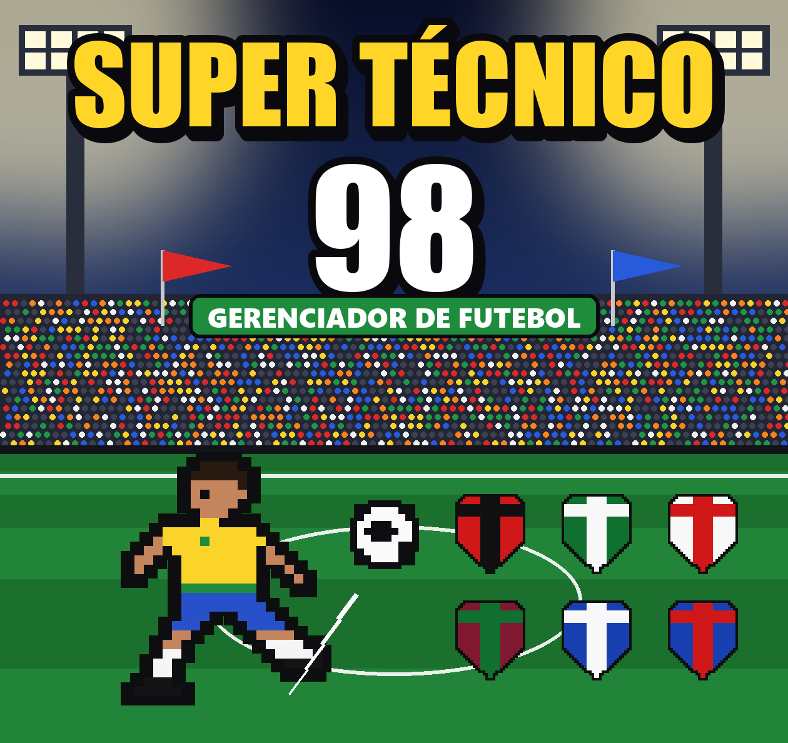
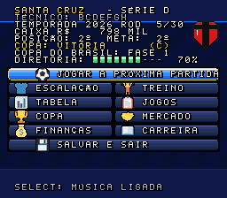
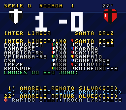

# Super Técnico 98

Gerenciador de futebol para **Super Nintendo**, uma homenagem ao Elifoot 98 feita do zero em assembly 65816.
Desenvolvido por **Ramon de Oliveira**.

## Jogar
Baixe [`SuperTecnico98.sfc`](SuperTecnico98.sfc) e abra num emulador de SNES (Mesen, bsnes, Snes9x)
ou grave num cartucho flash (EverDrive, FXPAK).

 

São 64 clubes brasileiros em 4 séries, Copa do Brasil, mercado de transferências, finanças, carreira de técnico
e 3 espaços de save. Os 1.408 jogadores são inventados e podem ser trocados no `editor.html`.

Controles, conteúdo e detalhes do cartucho estão no [LEIAME.md](LEIAME.md).
O manual está em [`cartucho/manual_super_tecnico_98.pdf`](cartucho/manual_super_tecnico_98.pdf) e o trailer em
[`trailer/trailer_super_tecnico_98.mp4`](trailer/trailer_super_tecnico_98.mp4).

## Recompilar
Requer Node.js, Python com Pillow e duas ferramentas que não acompanham o repositório:
- [cc65](https://cc65.github.io/) extraído em `tools/cc65` (o build usa `tools/cc65/bin/ca65` e `ld65`);
- [Mesen 2](https://www.mesen.ca/) em `tools/mesen` para jogar e em `teste/mesen` para os testes automáticos.

Depois é só rodar `node build.js` (ou dois cliques em `GERAR ROM.bat`).

Projeto de fã, sem vínculo com o Elifoot original nem com os clubes citados.
Os ícones dos menus vêm do [Twemoji](https://github.com/twitter/twemoji) (CC-BY 4.0).
